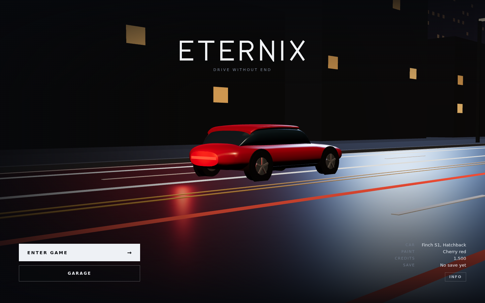
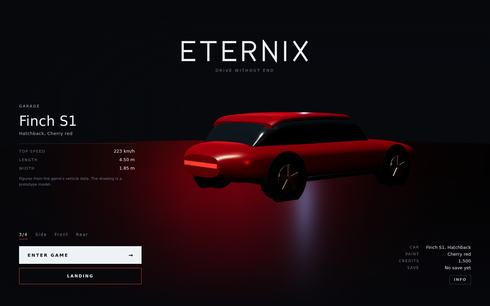
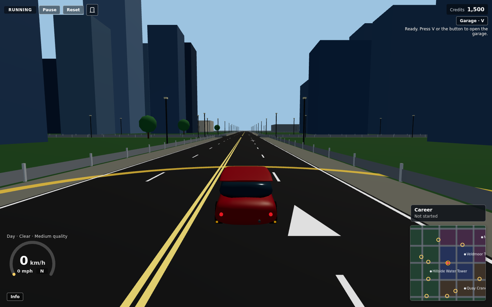
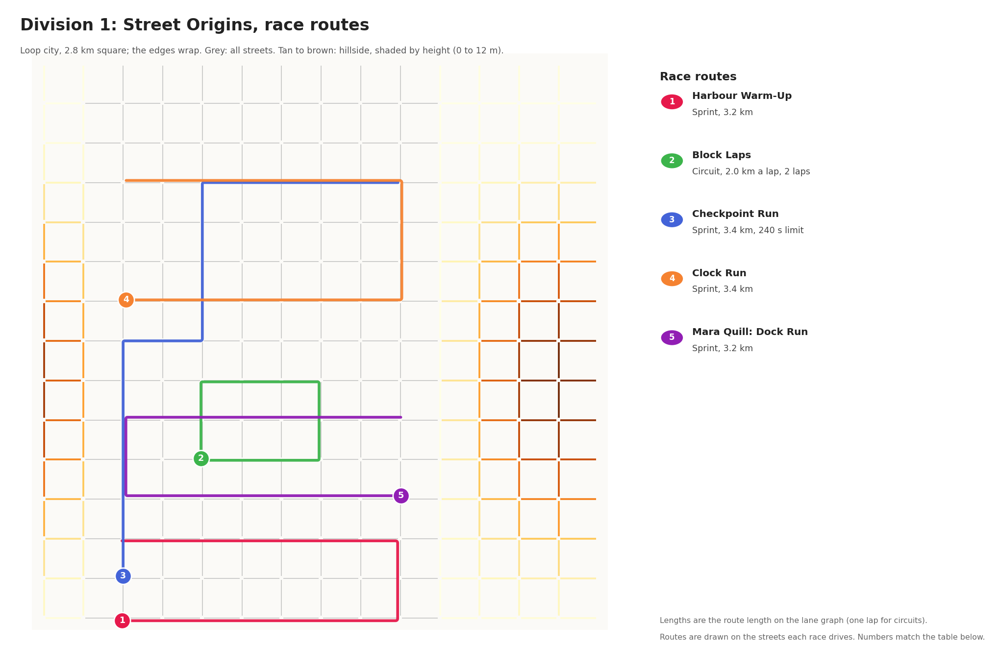
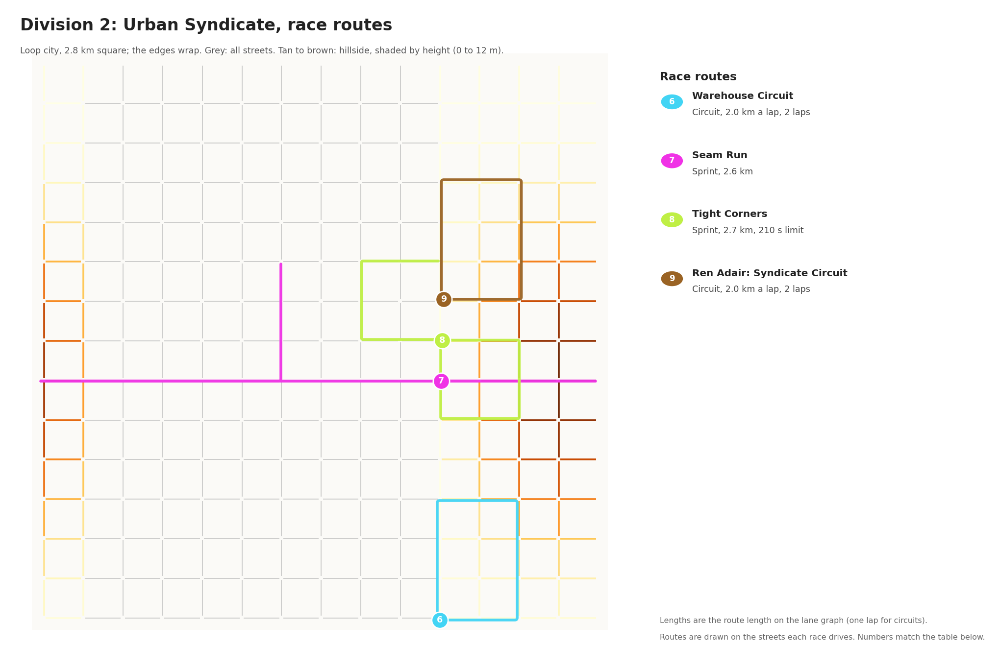

# ETERNIX

ETERNIX is a browser 3D open-world street racer. You drive a procedurally built car through a looping city, race rival
drivers, and try to outrun the police. It runs in the browser, with no server and no account.







> **Status: development preview.** Some systems are complete and tested. Others are planned and not built. See
> [Known limitations](#known-limitations).

## Features

- **Driving.** A fixed-step simulation of one car with throttle, brake, steering, handbrake, drift, and wheel spin, and a
  chase camera. The car is controlled with the keyboard.
- **Open world.** The default world loops at its edges (`?world=loop`). A finite city is also available (`?world=city`).
  Roads have four 3.6 m lanes.
- **Traffic and rivals.** Traffic cars and rival drivers share the roads.
- **Races.** Free-roam races with checkpoints. Every race is a field of six: the player and five rivals. The player starts
  last on the grid, and rivals go faster the further up the order they are. In a race, rivals drive at 2.5 times
  their event pace. Places 5 and 6 pay nothing. The Clock Run is the
  one solo race, so it is outside the six-racer rule. A race start needs confirmation.
- **Career.** Race progression. Divisions 1 and 2 are populated (Division 2 adds traffic on the route). Divisions 3 to 5 are planned only.
- **Police pursuit.** The police detect the car, pursue it, and lose it after an escape and a cooldown. Pursuing police
  ignore the normal traffic rules and aim just behind the car. A bust needs contact in range while the car is nearly
  stopped for 2.5 s; a tag alone does not bust. A ram locks driving for 1.5 s and brakes the car to a stop, so a rammed car
  can be held. A bust sends the car back to the spawn and takes 40% of your credits. During a pursuit, police drive at
  2.5 times their normal pursuit speed.
- **Garage.** Buy from 32 catalogue cars with credits (20 original, 12 ground cars added in the first fleet tranche; flyers are not yet purchasable), upgrade in tiers, change the paint, and choose the car you drive.
  Some cars need a career rank before they can be bought. Cars cannot be sold.
- **Minimap.** Shows the route to the next checkpoint or destination.
- **Settings.** Time of day, weather, and a quality setting (keys `N`, `M`, and `U`). Time of day and weather change
  by themselves every 5 minutes, at random, while they are on the automatic cycle (key `L` turns it on or off). Setting
  either one by hand (`N` or `M`) stops that part's cycle, so your choice stays until you change it. The home page and the
  game share the same environment, and the HUD shows whether it is Auto or Manual.
- **Front page.** The ETERNIX front page has the garage showroom, and a loader that checks real readiness before it opens
  the game.
- **Confirmations.** Leaving the game and buying anything in the garage both ask first.

## Maps and race locations

The default world is the loop city: a 2.8 km square that wraps at its edges, so a car that leaves one side arrives on the
other. Division 1 (Street Origins) and Division 2 (Urban Syndicate) are both raced on this map. The hillside district
has real elevation, with a maximum road grade of 8 percent. In the maps, its streets are shaded from tan (low) to brown
(high).

Each division has its own map. Grey streets are the whole city. Coloured routes are the races: each one drives the
streets drawn, in order, and the number on its start marker matches the table below.

**Division 1: Street Origins**



**Division 2: Urban Syndicate**



| # | Division | Race | Type | Length | Area | Notes |
| --- | --- | --- | --- | --- | --- | --- |
| 1 | 1. Street Origins | Harbour Warm-Up | Sprint | 3.2 km | Harbour Front | Opening race of the Street Origins Cup. |
| 2 | 1. Street Origins | Block Laps | Circuit | 2.0 km a lap, 2 laps | Westgate Block | One local racer. |
| 3 | 1. Street Origins | Checkpoint Run | Sprint | 3.4 km | West Edge | Checkpoints and finish in 240 s. |
| 4 | 1. Street Origins | Clock Run | Sprint | 3.4 km | North Country Road | Solo time trial, no rivals. |
| 5 | 1. Street Origins | Mara Quill: Dock Run | Sprint | 3.2 km | Westgate Row | Rival challenge (Mara Quill). |
| 6 | 2. Urban Syndicate | Warehouse Circuit | Circuit | 2.0 km a lap, 2 laps | South Hillside Block | Traffic on the road. |
| 7 | 2. Urban Syndicate | Seam Run | Sprint | 2.6 km | Seam Street | Crosses the loop seam. Traffic on the road. |
| 8 | 2. Urban Syndicate | Tight Corners | Sprint | 2.7 km | Tight Corner Row | Checkpoints and finish in 210 s, traffic on the road. |
| 9 | 2. Urban Syndicate | Ren Adair: Syndicate Circuit | Circuit | 2.0 km a lap, 2 laps | Syndicate Quarter | Rival challenge (Ren Adair), traffic on the road. |

Lengths are the route length on the lane graph. A circuit's length is one lap. A race appears on the map only when it is
unlocked, and Division 1 races are removed when Division 1 is complete.

## Technology

Versions are taken from `package.json` and the lockfile.

| Area | Used |
| --- | --- |
| Language | TypeScript 5.9.3, strict mode |
| UI | React 19.3.1 |
| 3D rendering | three.js 0.186.1 with @react-three/fiber 9.8.2 |
| State | zustand 5.0.15 |
| Build | Vite 8.3.4 with @vitejs/plugin-react 6.1.2 |
| Tests | Vitest 4.1.11 |
| Lint | ESLint 10.12.0 with typescript-eslint 8.71.2 |
| Audio | Web Audio API, synthesized in code. No audio files. |

The browser scripts in `tools/` are Python with Playwright. They are used for manual regression checks and are not needed to
play the game.

## Prerequisites

- Node.js 20 or newer (checked with Node 20.20.2; the deployment workflow uses Node 22).
- npm.
- A browser with WebGL.

## Installation and local development

```bash
git clone <repository-url>
cd eternix
npm ci
npm run dev
```

Then open `http://localhost:5173/` for the front page, or `http://localhost:5173/play.html` for the game.

## Build, test, and check

| Command | What it does |
| --- | --- |
| `npm run dev` | Development server on port 5173. Includes the diagnostics panel and development-only hooks. |
| `npm run build` | Type-checks, then builds the static site into `dist/`. |
| `npm run preview` | Serves `dist/` on port 4173. |
| `npm run typecheck` | TypeScript check only. |
| `npm run lint` | ESLint over the repository. |
| `npm test` | Unit and integration tests. |
| `npm run check` | Type check, lint, tests, and build. Run it before you push. |

More detail is in [docs/development/SETUP.md](docs/development/SETUP.md).

## Deployment

The game is a static site, and it is set up for GitHub Pages. The workflow in `.github/workflows/deploy-pages.yml` runs `npm run check` (typecheck, lint, tests, and the production
build) and publishes `dist/` only if that passes, when changes are pushed to `main`. The repository owner must first set **Settings > Pages > Source** to
**GitHub Actions**. See [docs/deployment/GITHUB_PAGES.md](docs/deployment/GITHUB_PAGES.md).

## Controls

These are the controls in the game. The Info panel in the game and on the front page shows the same list.

| Key | Action |
| --- | --- |
| `W` or `↑` | Throttle |
| `S` or `↓` | Brake |
| `A` / `D` or `←` / `→` | Steer |
| `Space` | Handbrake |
| `Esc` | Pause |
| `R` | Reset the car |
| `E` | Confirm a race start |
| `Q` | Cancel a race start |
| `V` | Open the garage |
| `C` | Open the career |
| `N` | Set the time of day by hand (stops the automatic time cycle) |
| `M` | Set the weather by hand (stops the automatic weather cycle) |
| `L` | Turn the automatic time and weather cycle on or off |
| `U` | Change the quality setting |
| `Shift` + `` ` `` | Show or hide the diagnostics panel |

The game uses the keyboard only. There is no touch or gamepad input.

## Save data

The game saves to the browser's local storage. No data is sent anywhere.

| Key | What it holds |
| --- | --- |
| `street-racer.save` | The save file: credits, owned cars, upgrades, paint, the active car, and career progress. |
| `street-racer.save.backup` | A backup copy of the save file. |
| `street-racer.settings` | Quality settings. |

The save changes when the garage or career state changes. The position of the car in the current drive is not saved.
Clearing the site's data in the browser removes the save. The keys keep their original names, so existing saves still load.

## Project structure

```
index.html          front page (landing, garage showroom, loader)
play.html           the game page
src/
  prototype/eternix/  front-page code (landing, loader, showroom)
  engine/ simulation/ fixed-step driving simulation (no React)
  render/             three.js renderer and render loop
  world/ traffic/ ai/ pursuit/ race/ career/ garage/ vehicles/ navigation/ audio/
  ui/                 HUD, garage, career, minimap, and the confirmation popup
  state/ config/      zustand stores and tuning values
  save/ input/ diagnostics/ core/
public/             favicon, icons, web manifest, .nojekyll
tools/              Python browser scripts (Playwright)
docs/               architecture, development, deployment, plans, history, assets
```

The architecture overview is in [docs/architecture/OVERVIEW.md](docs/architecture/OVERVIEW.md).

## Known limitations

- **Keyboard only.** There is no touch or gamepad input. A phone or tablet cannot drive the car.
- **Career.** Divisions 3 to 5 are planned, not built. Division 2 is built.
- **Garage.** Cars cannot be sold.
- **Front page.** The car on the front page is the same procedural model for every save.
- **Driving model.** The handling is tuned for playability. It is not a realistic physics simulation.
- **Performance.** Frame rate has been checked only with software WebGL in headless Chromium. It has not been measured on
  real hardware.
- **Multiplayer.** There is none.
- **Development preview.** Some systems are still being tuned. Expect rough edges.

## Contributing

See [CONTRIBUTING.md](CONTRIBUTING.md). Report security problems as described in [SECURITY.md](SECURITY.md).

## License

Released under the MIT License. See [LICENSE](LICENSE).

## Suggested repository settings

These are not set by the repository. The owner can set them on GitHub:

- **Description:** "ETERNIX: a browser 3D open-world street racer built with TypeScript, React, Three.js, and react-three-fiber."
- **Topics:** `racing-game`, `open-world`, `typescript`, `react-three-fiber`, `threejs`, `webgl`, `browser-game`
- **Social preview:** upload `docs/assets/social-preview.png`.
